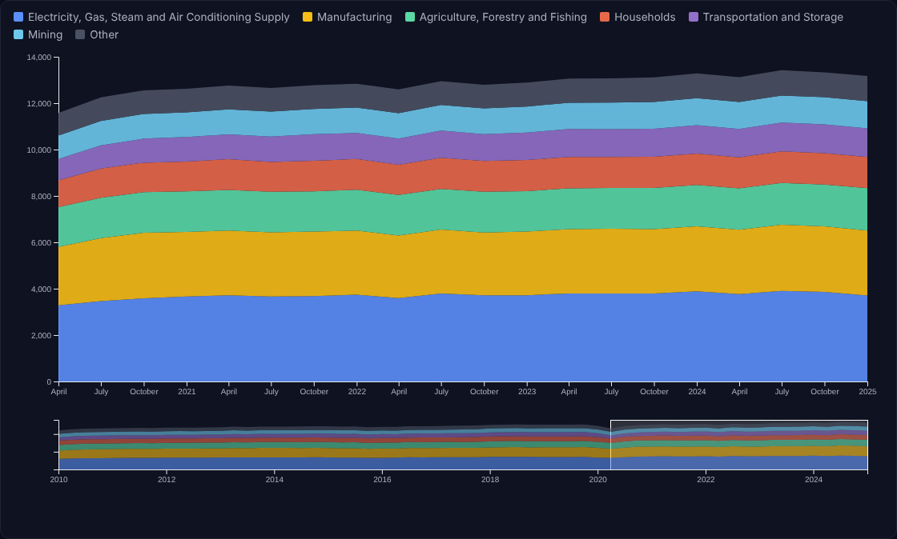

# Emissions Explorer

**[Live site →](https://mam084.github.io/Emissions_Explorer/)**

An interactive D3 visualization of quarterly greenhouse gas emissions from 2010 to 2025. Pick a region, then break its emissions down by economic sector or by gas to see what's driving the trend, including the 2020 pandemic dip and rebound.



## What it shows

- **Stacked area chart** of emissions for one region at a time, grouped by sector or by gas type
- **Absolute or percent-change view**: raw emissions in million metric tons of CO₂ equivalent, or each series' change relative to 2010
- **Seasonally adjusted or raw data**
- **Overview strip with a brush** for zooming into any stretch of time
- **Top 6 series plus "Other"**, so the chart stays readable while stacked totals stay complete
- **Clickable legend** to dim or restore a series, and hover tooltips with exact values

## Key findings (2024 vs. 2010, seasonally adjusted)

- World emissions rose about **17%**. Asia grew **39%** and Africa **21%**, while Europe fell **16%** and the Americas **6%**.
- The pandemic dip was sharp but brief: world emissions fell about **9%** from late 2019 to mid-2020 and were back above pre-pandemic levels within a year.
- **Electricity, gas, and steam supply** is the largest sector at about 29% of 2024 emissions, followed by manufacturing (21%) and agriculture (14%).
- **Carbon dioxide** makes up about 75% of emissions and methane about 18%.

## Data

[IMF Climate Change Indicators Dashboard](https://climatedata.imf.org/): quarterly greenhouse gas air emissions accounts, compiled from OECD, UNFCCC, EDGAR, and IEA sources, for 25 world regions and economic groupings.

The source file has overlapping rows, so each view selects one consistent slice:

| Overlap in the file | How the app handles it |
|---|---|
| Every series appears seasonally adjusted and not | A control picks one |
| "Greenhouse gas" is the total of the individual gases | Sector view uses the total for each sector; gas view excludes the total |
| "Total Industry and Households" is the sum of the sectors | Gas view uses it; sector view excludes it |
| Regions overlap (World, G20, continents, sub-regions) | Only one region is shown at a time |

## Run locally

```bash
python3 -m http.server 8000
# then open http://localhost:8000
```

`explore_emissions.py` regenerates the exploratory static figures in `images/` (requires pandas and matplotlib).

## Files

| File | Purpose |
|---|---|
| `index.html` | Page layout, controls, and write-up |
| `script.js` | D3 chart: data reshaping, stacking, brushing, legend, tooltips |
| `emissions.csv` | IMF quarterly emissions data |
| `explore_emissions.py` | Static exploratory figures |
| `images/` | Output of `explore_emissions.py` |

*Built for a data visualization course in the UC San Diego M.S. in Data Science program.*
